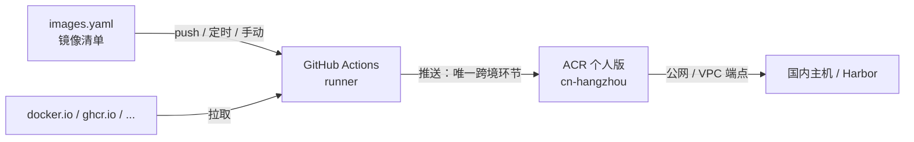

# ACR-Registry

用 GitHub Actions 把海外镜像（Docker Hub、GHCR、Quay、registry.k8s.io 等）按白名单同步到阿里云 ACR 个人版，国内主机直接从 ACR 拉取，不依赖代理或 VPS。

## 工作原理



- 跨境只发生在 runner 推送到 ACR 这一段，方向是进入国内云厂商端点，不会触发封锁
- 国内主机的拉取全部在境内完成

## 特性

- **白名单同步**：只同步 `images.yaml` 中列出的镜像
- **tag 任意填写**：`1.31.3`、`1.26-alpine`、`latest` 均可；上游不存在时提示「未找到」并列出相近 tag
- **按平台同步**：默认 `linux/amd64`，可为单个镜像加上 `linux/arm64` 等
- **digest 比对跳过**：目标中各平台 digest 与上游一致时不重复推送
- **单平台无损复制**：目标 digest 与上游完全一致

## 目录结构

```
.
├── images.yaml                     # 镜像清单
├── scripts/sync.sh                 # 同步脚本
└── .github/workflows/
    ├── sync.yml                    # 同步：push / 每天 02:00 / 手动
    └── check-versions.yml          # 手动：列出各镜像最新的固定版本 tag
```

## 快速开始

1. 准备 ACR 个人版实例和命名空间，开启「自动创建仓库」
2. 在 Docker Hub 创建一个 **Public Repo Read-only** 的 access token
3. 在仓库 **Settings → Secrets and variables → Actions** 中配置：

   | 页签 | 名称 | 说明 |
   |---|---|---|
   | Secrets | `ACR_USERNAME` | ACR「访问凭证」页面显示的用户名 |
   | Secrets | `ACR_PASSWORD` | ACR 固定密码 |
   | Secrets | `DOCKERHUB_USERNAME` | Docker Hub 用户名 |
   | Secrets | `DOCKERHUB_TOKEN` | Docker Hub 只读 token |
   | **Variables** | `ACR_REGISTRY` | `registry.cn-hangzhou.aliyuncs.com` |
   | **Variables** | `ACR_NAMESPACE` | `fishpie` |

4. 手动运行 **check-versions**，按结果更新 `images.yaml`
5. 推送到 `main`，**sync-images** 自动运行，结果见该次运行的 Summary 页

> [!WARNING]
> `ACR_REGISTRY` 和 `ACR_NAMESPACE` 必须建在 **Variables** 页签，而不是 Secrets。
> 放错位置时 `vars.*` 为空，`docker/login-action` 会默认登录 docker.io 并报 `malformed HTTP Authorization header`。
> `sync.yml` 中的 Preflight 步骤会提前拦截这个问题。

完整的部署步骤见 [docs/acr-image-sync.mdx](https://nimbus.fishpie.top/infrastructure/acr-image-sync/)。

## 镜像清单格式

```yaml
defaults:
  platforms: [linux/amd64]

images:
  - source: docker.io/library/nginx          # 必须写完整路径
    tags: ["1.31.3"]

  - source: docker.io/library/golang
    tags: ["1.26-alpine"]                     # 浮动 tag：上游更新后定时任务会重新同步

  - source: docker.io/victoriametrics/vlogscli
    tags: ["v1.52.0"]
    platforms: [linux/amd64, linux/arm64]     # 覆盖默认平台

  - source: ghcr.io/foo/some-very-long-name
    tags: ["1.0.0"]
    target: foo-short                         # 覆盖自动生成的仓库名
```

| 字段 | 必填 | 说明 |
|---|---|---|
| `source` | 是 | 含注册表主机名的完整路径 |
| `tags` | 是 | tag 列表，任意上游存在的 tag |
| `platforms` | 否 | 覆盖 `defaults.platforms`，如 `linux/arm/v7` |
| `target` | 否 | 自定义目标仓库名 |

## 命名规则

ACR 仓库名只有一级，路径按以下规则拼接：

| 上游 | ACR 仓库 |
|---|---|
| `docker.io/library/nginx` | `fishpie/library_nginx` |
| `docker.io/victoriametrics/victoria-logs` | `fishpie/victoriametrics_victoria-logs` |
| `ghcr.io/foo/bar` | `fishpie/ghcr-io_foo_bar` |
| `registry.k8s.io/pause` | `fishpie/registry-k8s-io_pause` |

- `docker.io` 省略主机名；其他注册表的 `.` 换成 `-`
- 路径中的 `/` 换成 `_`，全部转小写
- 超过 64 个字符时报错，用 `target` 指定短名

## 拉取镜像

```bash
docker login --username=<ACR 用户名> registry.cn-hangzhou.aliyuncs.com
docker pull registry.cn-hangzhou.aliyuncs.com/fishpie/library_nginx:1.31.3
```

同地域的阿里云 ECS 可改用 VPC 端点 `registry-vpc.cn-hangzhou.aliyuncs.com`，速度更快且不计公网流量。

## 常见问题

| 现象 | 原因 | 处理 |
|---|---|---|
| `Login ACR` 报 `malformed HTTP Authorization header` | `ACR_REGISTRY` 未读到值，登录到了 docker.io | 在 **Variables** 页签补上变量 |
| `xxx:tag 未找到，上游不存在该 tag` | tag 拼写错误或上游未发布 | 参考报错中列出的相近 tag，或运行 check-versions |
| `上游仓库不存在或无权访问` | `source` 路径写错，或私有仓库未登录 | 检查 `source` |
| `上游没有 linux/xxx 平台` | 上游未发布该架构 | 从 `platforms` 中移除 |
| `推送后校验 digest 不一致` | 推送未完成或被 ACR 改写 | 重跑；多次出现请检查 ACR 配额 |
| 定时任务不再运行 | 公开仓库 60 天无提交，GitHub 自动停用 | 在 Actions 页面重新启用 |

## 安全

- 凭据只存放在 GitHub Secrets，不要写进任何文件或 issue
- 本仓库公开，Actions 日志也公开：不要在 workflow 中使用 `set -x`
- Docker Hub token 只需只读权限
